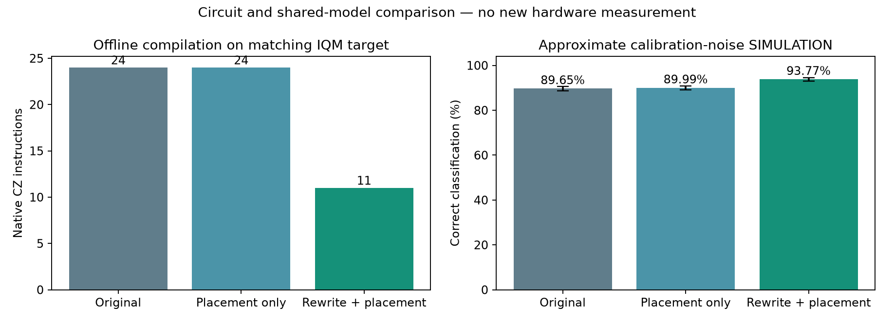
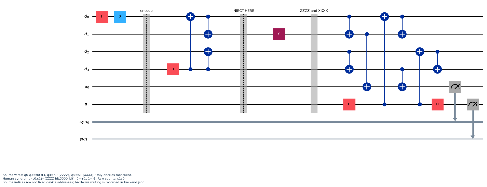
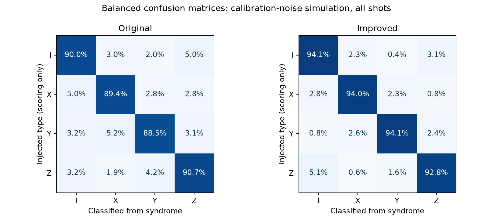

# QUBLITZ 2026 — Verified hardware-circuit improvements

## Evidence summary

The attached project was updated in place after verifying the source ZIP and running its untouched regression suite: **300 passed in 17.88 seconds**. The original 150-case suite was reproduced at 512 shots per case: 76,800 ideal shots, 100% expected results, no shot exclusion. The updated full suite has **718 passing tests**, 0 failures, 0 errors and 0 skipped. Levels 1–3 and the original Level-4 builder remain available.

**No new IQM hardware comparison has been run in this environment.** Authenticated server/QPU configuration was not present. The user-supplied physical pilot export is included; it is distinct from archived fake Garnet results and the new simulations.

| Evidence source | Original | Improved |
|---|---|---|
| Archived user-supplied IQM export, expected 11 | 24/32 = 75%; 95% Wilson 57.89–86.75% | No new hardware result |
| Verified offline native compilation, pilot example | 24 CZ, depth 45 | 11 CZ, depth 17 |
| Ideal exact-native verification | 78/78 input/error cases pass | 78/78 input/error cases pass |
| Shared approximate calibration-noise simulation, balanced four types | 89.65% | 93.77% |

The rewrite removes **54.17% of native CZ instructions** and reduces gate-layer depth by **62.22%** on the verified offline target. The modeled gain is **4.13 percentage points**, with approximate 95% Newcombe/Wilson interval **2.94 to 5.32 points**. This interval measures simulation shot uncertainty, not uncertainty about whether the model describes the real device.

## 1. What the physical baseline establishes

Job ID: `01a1fff5-31e3-744f-89da-cb1d14f7bacb`. The supplied export contains measurement keys `syn_2_0_0`, `syn_2_0_1`, and these counts:

| Exported raw string | Count |
| --- | --- |
| 00 | 1 |
| 01 | 4 |
| 10 | 3 |
| 11 | 24 |

Assuming the documented Level-4, +i, Y-on-d1 pilot command, the expected outcome is 11. It occurred 24 times out of 32: **75% syndrome-classification success**, not logical-state fidelity. The configuration is **likely, inferred from the documented command**. The source ZIP contains no `results/iqm-pilot/job.json`, physical submitted circuit, physical layout, server/QPU name or verified physical calibration linkage. Those require the original pilot receipt and its submitted-circuit metadata. The calibration snapshot alone cannot establish that linkage.

The original archived *local* native QPY is available. Its gate parameters, operation order, qubit/classical-bit mappings, global phase and classical registers match the reconstructed original path exactly: **True**. Circuit names are not part of this computational fingerprint. This validates the reconstruction of the local baseline; it does not establish that the physical pilot used exactly that native circuit.

The symmetric 11 result cannot resolve which raw character represents which check. We therefore do not assign the archived raw 01/10 counts to X/Z. The updated Qiskit path is independently checked with asymmetric controls and the installed IQM adapter formatter: native `syn[0]=1,syn[1]=0` becomes Qiskit `01` and classifies X; `syn[0]=0,syn[1]=1` becomes `10` and classifies Z. The prepared physical comparison includes both controls.

## 2. Calibration, placement and compiler metrics

The snapshot is a valid IQM `quality-metric-set`, device label `M194_F0W2114_P08_B15`, created `2026-11-21T02:43:01.804237+00:00`. Its described calibration ID is `ea681de1-9661-41e5-bd6f-cb524fa056a6`. All 598 observations were inspected; 0 were marked invalid. Parsing checks timestamps, finite values, uncertainties, units, probabilities, required metrics and conflicting duplicates.

It supplies PRX metrics for 20 qubits and CZ metrics for 30 edges. CZ fidelities range from 0.9908567 to 0.9990728. The 20 names and all 30 links match the official offline `IQMFakeGarnetBackend` topology. This is topology compatibility, not proof of physical device identity. The fake target has calibration ID zero; it is not the physical calibration.

Unheralded `metrics.ssro.measure.constant` rates are used separately for 0-to-1 and 1-to-0 readout errors. The parser deliberately excludes `:herald=...` values from the primary metric. T1/T2 values are checked as seconds. The snapshot lacks pulse durations, so **physical duration estimates and idle-decoherence timing are unavailable**; no duration is invented from depth.

The selector takes only the backend, calibration and search budgets. A fixed +i/no-error reference is used before constructing any evaluation cases. It searches at most 24 layouts per main variant and transpiler seeds 7, 19 and 43. Original placement candidates are prefiltered from at most 16 six-cycle footprints and their role permutations; every final rank uses the actual routed native circuit. The selected layout/seed is frozen for all evaluation inputs and errors.

The ranking heuristic is a conservative negative-log gate/readout proxy: gate fidelities minus two reported standard uncertainties, worst-bit unheralded readout cost, a 0.001-per-CZ routing penalty and a small depth tie-breaker. **It is not an accuracy prediction.** No evaluation shot counts were used for selection. Full candidate scores are retained in `results/improvement/search.json`.

Metrics below are for the documented +i/Y1 example on the offline target:

| Candidate | CZ | Native R | Depth | ZZZZ / XXXX measurement sites | Ranking heuristic |
| --- | --- | --- | --- | --- | --- |
| Original path | 24 | 52 | 45 | QB2, QB4 | 0.171997 |
| Calibration placement only | 24 | 51 | 46 | QB4, QB8 | 0.164481 |
| Earlier bridge rewrite | 13 | 37 | 20 | QB10, QB1 | 0.124450 |
| Selected rewrite + placement | 11 | 33 | 17 | QB1, QB10 | 0.112659 |

The placement-only change does not reduce CZ count in this bounded search and adds one layer. Its lower heuristic score is not evidence of a hardware improvement. The rewrite has no SWAP routing on the selected six physical qubits. The earlier 13-CZ bridge strategy remains available and was checked; its pilot metrics are shown for comparison.

Layouts are listed in source-wire order `(d0,d1,d2,d3,aZ,aX)`. Initial and final layouts differ when routing moves quantum states:

| Variant | Initial physical names | Final physical names |
| --- | --- | --- |
| original | QB4, QB3, QB1, QB2, QB9, QB5 | QB3, QB9, QB1, QB5, QB2, QB4 |
| placement | QB8, QB3, QB9, QB14, QB4, QB13 | QB13, QB3, QB14, QB9, QB4, QB8 |
| improved | QB5, QB2, QB9, QB4, QB1, QB10 | QB5, QB2, QB9, QB4, QB1, QB10 |

The improved assignment is d0=QB5, d1=QB2, d2=QB9, d3=QB4, aZ=QB1, aX=QB10 for this snapshot/target. It is selected from the target rather than hardcoded. Live preparation repeats the topology validation and ranking using the actual selected backend. `--pin-calibration` optionally requests the snapshot calibration ID; otherwise current backend calibration and its ID match/mismatch are recorded.



## 3. Why the shallower circuit is equivalent

The codewords remain `(0000+1111)/sqrt(2)` and `(0011+1100)/sqrt(2)`. Input is on d0. The improved encoder is H(d3), CNOT(d3,d0), CNOT(d0,d1), CNOT(d3,d2): three CNOTs rather than four. For logical input b and the H-generated bit g, output is `(b XOR g,b XOR g,g,g)`, giving exactly the original codewords with the same phase. Both encoding columns are explicitly compared as an isometry.

Let C be CNOT(d0,d1) followed by CNOT(d2,d3). Conjugation by C maps ZZZZ to Z1 Z3 and XXXX to X0 X2. Apply C, write those two shorter checks into aZ and aX, then apply C again to restore the data. This still uses eight check CNOTs, but the interaction graph is a nearest-neighbor six-cycle. A chord between d3 and d0 supports the three-CNOT encoder, so all 11 source entanglers compile directly to 11 native CZs.

The error-injection barrier remains after complete encoding and before extraction. We do not commute the known injected error into preparation or cancel the protected encoding across that boundary. Recovery/classification never receives the hidden error, its location or input label. Only the harness knows those for preparation and scoring; error type is obtained from the two measured syndrome bits.



Source wire order is q0–q3=d0–d3, q4=aZ for ZZZZ and q5=aX for XXXX. Human syndrome order is `(ZZZZ,XXXX)`, with bit 0 meaning +1 and bit 1 meaning −1. Qiskit raw strings are `syn1syn0`: I=00, X=01, Y=11, Z=10. Only the two ancillas are measured.

## 4. Verification and retained results

The updated regression suite has 718 passes. New tests cover strict calibration parsing, unheralded/asymmetric readout, the IQM measurement-key adapter, fair-analysis rejection of mismatched cases/shots, pending/completed/failed job receipts and duplicate-submission protection.

All 13 errors across all six logical inputs were checked for each main candidate: **234 exact compiled-native cases**. The verifier accounts for the compiler's final wire permutation, traces out the correct physical ancillas and compares data to the encoded state immediately after the injected error. Minimum data-preservation fidelity is **0.999999999999998**, within floating point error of 1. Every case also passed 512 ideal finite shots. This checks preservation of complex superpositions, not just classical bit frequencies.

The source extraction rewrite is also compared to the original as an isometry on all 16 data basis states with ancillas zero. Equality of those columns establishes the same linear measurement map for arbitrary data superpositions. Preservation without collapse applies to the promised encoded-and-errored stabilizer eigenstates. Both source encoders, including the 13-CZ bridge fallback, pass all 78 source cases.

Full records, raw counts and exact circuits are retained in `ideal-native-cases.json`, `.csv`, `.qpy`, `circuits/`, the test JUnit file and `study.log`. Levels 1–3 and the original 150-case simulation remain regression-tested; the untouched baseline evidence is under `results/improvement/baseline/`.

## 5. Shared approximate calibration-noise comparison

The model uses independent depolarizing errors from exported fidelities and asymmetric unheralded readout errors. Exported F is treated as average gate fidelity, giving depolarization parameter `2*(1-F)` for one qubit and `4/3*(1-F)` for two qubits. One PRX metric is assigned per native R instruction, regardless of its angle/implementation. Native R/CZ names are retained so those channels actually attach.

No pulse durations are available, so there is no guessed idle/T1/T2 model. Leakage, coherent errors, crosstalk, correlations, initialization faults and drift are omitted. Consequently this model is not a forecast of physical accuracy and is not established by the 32-shot pilot. It does not reproduce all real-device effects that may explain the pilot's lower rate; the attachments do not identify the cause.

Evaluation uses seeds 49157 and 82799, separate from all transpiler tuning seeds. All 13 locations/type configurations on +i were sampled at 512 shots per seed, per variant. The directly comparable balanced subset below is I, X1, Y1, Z1: 1024 shots per case, 4096 per variant. All shots are retained; no mitigation or post-selection is applied.

| Variant | Correct / total | Classification success | 95% Wilson interval |
| --- | --- | --- | --- |
| original | 3672/4096 | 89.65% | 88.68–90.54% |
| placement | 3686/4096 | 89.99% | 89.03–90.87% |
| improved | 3841/4096 | 93.77% | 92.99–94.47% |

Placement-only change: 0.34 percentage points, with an interval spanning zero. Rewrite plus placement: **+4.13 percentage points** in this model. Per-case histograms, confusion counts, row-normalized confusion matrices, macro-type success and uncertainty are in `noise-balanced-analysis.json`; the full 13-configuration results and both evaluation seeds are retained separately.



## 6. Prepared fair physical comparison

The balanced protocol prepares **8 native circuits, 256 shots each, 2048 total shots**, all on the same backend/calibration instance and in one job. Cases are +i with I, X1, Y1, Z1, including the documented pilot and both asymmetric controls. Case blocks alternate original/improved and improved/original to reduce ordering bias. Inputs, errors and shots match within every pair. Each submitted circuit has a unique name and retains its exact native QPY, gate/register fingerprint, layout and measurement sites.

The new analysis reports raw histograms, per-case success, confusion matrices, aggregate all-shot success, macro-type success, Wilson intervals and absolute percentage-point changes with Newcombe/Wilson intervals. It refuses mismatched shots, case sets, input/error metadata, duplicate cases and unverified bit-order formats. The archived pilot is historical context; do not subtract its 75% from a new balanced aggregate. Improvement must be assessed against the paired original circuits in the new job.

After applying the source patch to the original folder (or copying its `results/iqm-pilot` receipt into the updated project), the next hardware command is:

```bash
.venv/bin/python -m minesweeper compare --mode run --calibration data/calibration.json --suite balanced --shots 256 --out results/iqm-comparison --prompt-token
```

The command reuses server/QPU settings from `results/iqm-pilot/job.json` if environment/CLI settings are absent. It never reads or stores a token from that receipt. `--prompt-token` enters a missing token privately. Choose the authorized physical QPU. If no receipt is present, supply the existing IQM_SERVER_URL and IQM_QUANTUM_COMPUTER settings or --url/--computer.

If polling times out, the job ID is already saved. Retrieve it without resubmitting:

```bash
.venv/bin/python -m minesweeper compare --mode retrieve --out results/iqm-comparison --prompt-token
.venv/bin/python -m minesweeper compare --mode analyze --result-file results/iqm-comparison/job.json
```

For more evidence, predeclare 1024 shots per circuit and use a new output directory. `--suite locations` covers all 13 configurations on +i; `--suite full` covers all 78 inputs/errors. The original single-pilot workflow remains unchanged: `python -m minesweeper iqm --mode retrieve --result-file results/iqm-pilot/job.json` with private token configuration.

## 7. Reproduce and submit

```bash
bash scripts/setup.sh
.venv/bin/python scripts/run_tests.py
.venv/bin/python scripts/improve_and_compare.py
.venv/bin/python scripts/report_improvement.py
```

Or run `bash scripts/reproduce_improvement.sh`. It submits no physical job. Dependency versions remain pinned to Python 3.12, Qiskit 2.1.2, Aer 0.17.2 and iqm-client 36.0.0. The original challenge PDF is in `docs/source/challenge.pdf`; Level 4 requires classification rather than location recovery. The present work preserves that requirement and the earlier levels.

**Still needed:** run the prepared paired comparison on the authorized physical device, retrieve its actual counts and confirm device/calibration identity. A positive matched-case/aggregate change, with uncertainty and controls reported, would be evidence of hardware improvement. The current evidence supports a shorter verified circuit and a model-based improvement, not a measured physical improvement. Retain the original pilot receipt to resolve the archived run's missing linkage.

Official references: [IQM Qiskit guide](https://docs.iqm.tech/iqm-client/user_guide_qiskit.html), [IQM backend API](https://docs.iqm.tech/iqm-client/api/iqm.qiskit_iqm.iqm_provider.IQMBackend.html), [Aer depolarizing channel](https://qiskit.github.io/qiskit-aer/stubs/qiskit_aer.noise.depolarizing_error.html). Adapter ordering was additionally verified against the installed IQM 36.0.0 formatter with X/Z controls.
