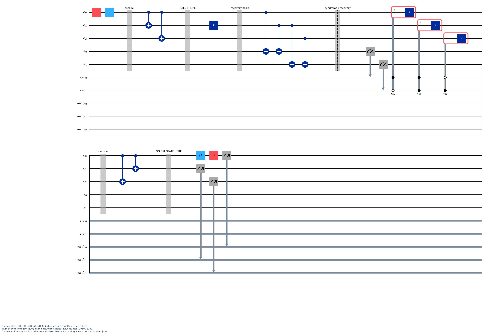
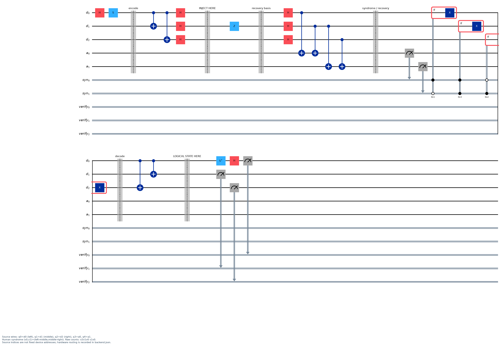
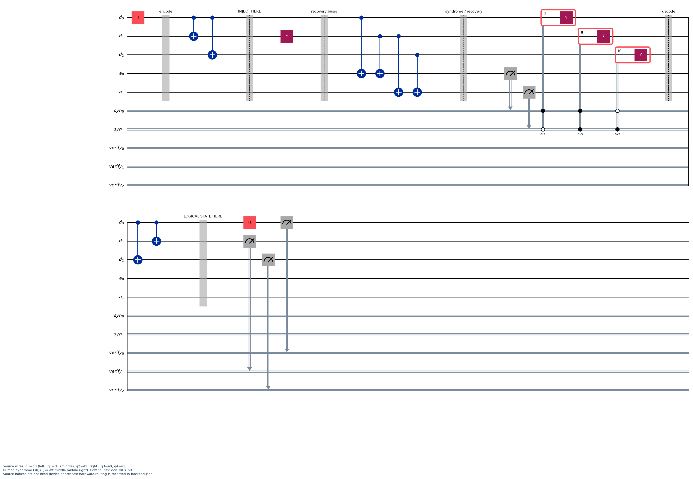
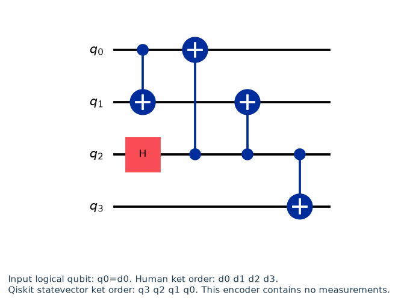
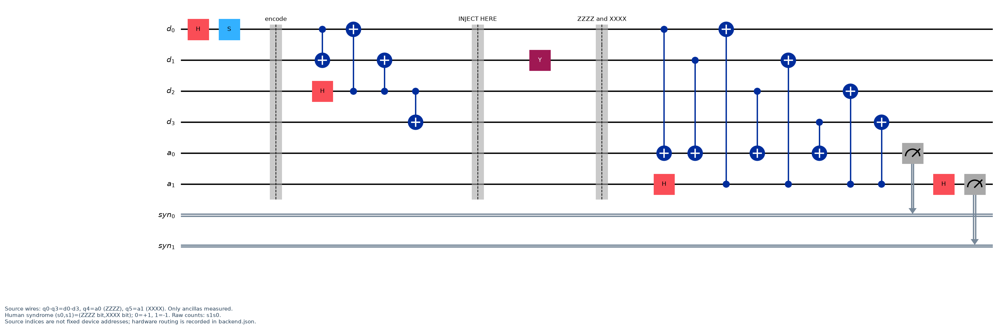

# QUBLITZ 2026 — Quantum Minesweeper

## Results and reproducibility report

Generated @@DATE@@ from retained result files. The entire provided eight-page PDF was read; `docs/source/` retains the original, complete extraction and SHA-256 fingerprint. The source PDF defines success. In particular, Level 4 requires type classification while preserving encoded information, and PDF pp. 5–6 requires actual IQM execution and experimental evidence.

**Current IQM status: @@HARDWARE_STATUS@@**

This project implements all four levels. All permitted error configurations have passed ideal simulation. The physical-QPU requirement is outstanding unless a completed IQM receipt is listed below. Local IQM-target compilation and fake-backend sampling do not meet that requirement.

## 1. Observed results

@@SUMMARY@@

Each case used 512 shots, seed 2026, with all shots retained. Total: **150 cases and 76,800 shots**. The primary results are exact-state verification plus ideal finite-shot sampling, not hardware measurements. The smallest Level-4 preservation fidelity differs from 1 by approximately 1e-15, consistent with floating point arithmetic. Assertions allow 1e-10.

@@TESTS@@

The 300-test snapshot includes 150 promised quantum-state cases, 24 initial Level-1 milestone checks, 72 measured/feed-forward quantum-state checks, 12 equal-global-phase checks, 13 explicit cross-input syndrome-invariance checks for Level 4, codeword/stabilizer checks, a wrong-recovery control, raw-order checks, complex-amplitude checks, coverage assertions, eight IQM native-target checks and four hardware-job bookkeeping checks. They are additional tests of 150 challenge cases, rather than 300 distinct error configurations.

Per-case data is in `results/simulation.json` and `results/cases.csv`. Every row records level, input, injected error/location, expected and observed syndrome, relevant exact fidelity, raw measurement counts, finite-shot metrics and retained fraction. JUnit and the complete pytest transcript are retained.

## 2. Wires, syndromes and measurement strings

| Level | Source data | Ancillas | Human syndrome order | Raw Qiskit count order |
|---|---|---|---|---|
| 1–3 | q0=d0 left; q1=d1 middle; q2=d2 right | q3=a0, q4=a1 | s0=left–middle; s1=middle–right | v2v1v0 s1s0 |
| 4 | q0=d0, q1=d1, q2=d2, q3=d3 | q4=a0, q5=a1 | s0=ZZZZ; s1=XXXX | s1s0 |

Human kets in this report are written d0 d1 d2 [d3], left to right. Qiskit's displayed statevector kets are highest index first. The classical registers are created as `syn`, then `verify`, so the later register prints first. The syndrome register integer is s0 + 2*s1, not the binary integer represented by the human text s0s1.

| Location | Human syndrome (s0,s1) | syn register integer | Levels 1–3 expected raw count |
|---|---|---:|---|
| No error | 00 | 0 | 000 00 |
| Left d0 | 10 | 1 | 000 01 |
| Middle d1 | 11 | 3 | 000 11 |
| Right d2 | 01 | 2 | 000 10 |

Dedicated tests use asymmetric left/right and X/Z patterns so reversing bits cannot pass unnoticed. The native IQM mapping is compiler-dependent and recorded separately in each `backend.json`. The data/ancilla source indices are not claims about fixed physical chip addresses.

## 3. Level 1 — correct one unknown X

**Success:** for I, X0, X1 and X2, recover any logical input after syndrome-based correction and decoding.

Place the logical input on d0, with d1=d2=0. CNOT(d0,d1) then CNOT(d0,d2) gives `alpha|000> + beta|111>`. Ancillas start in 00. CNOT(d0,a0), CNOT(d1,a0) compute d0 XOR d1. CNOT(d1,a1), CNOT(d2,a1) compute d1 XOR d2. Read a0,a1; recover according to the table above. Decode with CNOT(d0,d2), CNOT(d0,d1).

For a middle error, the complete walkthrough is:

| Stage | Data | Ancillas |
|---|---|---|
| Prepared | alpha|000> + beta|100> | 00 |
| Encoded | alpha|000> + beta|111> | 00 |
| X1 injected | alpha|010> + beta|101> | 00 |
| Syndrome written | alpha|010> + beta|101> | 11 |
| Ancillas measured | Same coherent superposition | Classical outcome 11 |
| X1 recovery | alpha|000> + beta|111> | 11 |
| Decoded | (alpha|0> + beta|1>) tensor |00> | 11 |

Both 010 and 101 have neighboring comparisons “different, different”. Extraction maps their superposition to `(alpha|010> + beta|101>) tensor |11>`. The same syndrome appears on both logical components, so reading it reveals no alpha/beta information. Directly measuring the data would reveal a component and destroy its coherence.



**Actual walkthrough result:** input +i, injected middle X, decoded-state fidelity 1, raw counts `{'000 11': 512}`. `results/demo-L1.json` includes preparation, encoding, injection, extraction, recovery, decoding and inverse-preparation amplitudes.

## 4. Level 2 — correct one unknown Z

**Success:** recover the input for I, Z0, Z1 and Z2. The physical error is Z at the marked injection boundary, not an X substituted by the test harness.

First consider one qubit. A direct computational-basis measurement of + or − gives 0 and 1 with equal probability. H makes their relative signs interfere: `H|+> = |0>` and `H|-> = |1>`. Their previously invisible sign difference becomes a distinguishable bit difference.

Encode with the two repetition CNOTs, then H on all three data qubits: `alpha|+++> + beta|--->`. **Inject Z at this point.** Apply H on all three again before parity extraction. Because `H Z H = X` and H squared is I, this entire segment is exactly a bit-flip error at the same location in the original repetition basis.

Recovery is therefore X in the rotated-back computational basis, followed by repetition decoding. The logical state is verified on d0 **after decoding and before the inverse input preparation**. We do not add another H after recovery; the second H layer already returned the data to that basis.



Actual +i/middle-Z walkthrough: fidelity 1, raw counts `{'000 11': 512}`. All 24 input/error combinations pass, including no error.

## 5. Level 3 — correct one promised Y

**Success:** recover for I, Y0, Y1 and Y2. The promise excludes unknown independent X/Z faults on different qubits.

Y contains a bit-flip component, and anticommutes with the same Z-parity checks as X. Consequently, the Level-1 syndrome still identifies its location. Since a nontrivial error is guaranteed to be Y, recovery applies Y at that location.

For a middle Y, `Y1(alpha|000> + beta|111>) = i alpha|010> - i beta|101>`. Reading syndrome 11 preserves these coefficients. Applying Y1 again restores `alpha|000> + beta|111>` exactly: Y squared is I.

If recovery uses only X, the state becomes `i(alpha|000> - beta|111>)`. Decoding leaves `i Z|psi>`. The global factor i is irrelevant, but the relative minus sign is a logical phase error.



**Observed controlled comparison:** input +, injected Y1. Correct Y recovery: fidelity 1. Deliberately incorrect X-only recovery: fidelity 0, output − up to global phase. Both have computational-basis probabilities (0.5,0.5), so a bit-frequency test would miss this failure. Reproduce with the Level-3 demo command in the README.

## 6. Why Levels 1–3 work for arbitrary amplitudes

Let V be the repetition encoder, S the syndrome-extraction unitary, E_j the permitted Pauli on a data qubit and R_s the recovery chosen from the observed syndrome. For a fixed error j, the two logical basis states receive the same syndrome s_j. Thus:

`R_(s_j) S E_j V|b> |00> = V|b> |s_j>`, for b=0 and b=1.

For X and Y the recovery is the identical Pauli, so its square is I on both basis states. For Level 2 the H sandwich is X exactly, with no input-dependent phase. After decoding, the two outputs are `|0>|00>|s_j>` and `|1>|00>|s_j>` with the same global phase (1 in these conventions).

Linearity then gives `(alpha|0> + beta|1>) |00>|s_j>` for arbitrary normalized complex alpha,beta. Restoring basis-state probabilities alone would not prove this; matching the phase on both basis states is essential. Twelve explicit tests compare the complete output vectors for both logical basis inputs under each permitted error. Additional tests use nontrivial unequal complex amplitudes.

## 7. Level 4 — classify an unknown Pauli type

**Success:** distinguish I/X/Z/Y using ancillas, without measuring data. Location is deliberately not inferred.

Choose two orthogonal codewords in the common +1 eigenspace of ZZZZ and XXXX:

`|0_L> = (|0000> + |1111>)/sqrt(2)`

`|1_L> = (|0011> + |1100>)/sqrt(2)`

These are orthonormal: their supports are disjoint and each is normalized. Each support has even bit parity, so ZZZZ acts as +1. Applying XXXX swaps the two equal-weight terms in either codeword, so it also acts as +1. Their arbitrary superposition inherits both properties. These two checks alone have a four-dimensional common +1 eigenspace; our encoding selects a two-dimensional subspace for one logical qubit.

With input on d0 and d1=d2=d3=0, use CNOT(d0,d1), H(d2), CNOT(d2,d0), CNOT(d2,d1), CNOT(d2,d3). For input b and the H-generated bit g, the resulting computational strings are `(b XOR g, b XOR g, g, g)`, equally weighted over g. They produce the codewords above.



To measure ZZZZ, start a0 in 0 and CNOT each data qubit into a0. To measure XXXX, start a1 in 0, apply H(a1), use a1 as control for CNOTs onto all four data, then H(a1). Measure only a0 and a1. These are compatible commuting checks.



| Error type | ZZZZ eigenvalue | XXXX eigenvalue | Human bits s0s1 | Raw s1s0 |
|---|---|---|---|---|
| I | +1 | +1 | 00 | 00 |
| X | −1 | +1 | 10 | 01 |
| Z | +1 | −1 | 01 | 10 |
| Y | −1 | −1 | 11 | 11 |

Let S_Z=ZZZZ and S_X=XXXX. For a single-qubit Pauli E, `S E = epsilon E S` where epsilon is +1 for commuting and −1 for anticommuting operators. Since `S|psi_L> = |psi_L>`, we have `S E|psi_L> = epsilon E|psi_L>`. Therefore the measured signs are determined by E's type, independently of alpha,beta and independently of location. X anticommutes only with S_Z, Z only with S_X, and Y with both.

For any permitted error, extraction produces `E|psi_L> tensor |s_Z s_X>`. The data density matrix after extraction is exactly the encoded data density matrix immediately after injection. This is a preservation check, not fidelity to the uncorrupted state. All 78 cases passed this check, and all 13 error configurations were checked explicitly for syndrome invariance across the six inputs. Only ancillas are measured in the classifier. Data measurement is never used to derive its answer.

## 8. Verification methods and source labels

**Exact ideal fidelity, Levels 1–3:** obtain the statevector after extraction, determine the actually populated syndrome branch, project onto that observed branch, and call recovery using only that syndrome. Decode, trace out the other wires and calculate `<psi|rho_out|psi>`. Check the two work-data qubits reset to 00. Separately compare coherent recovery. The 72 density-matrix tests run actual measured Qiskit `if_test` circuits and save d0's density matrix before inverse preparation, so the branch calculation is not the only verification of measured recovery.

**Exact ideal preservation, Level 4:** trace out the two ancillas before and after extraction. Compare the final data with the pure encoded-and-errored data state and check the Frobenius norm of the density-matrix difference is below 1e-10. Pure-target fidelity avoids numerical square-root instability in mixed-state fidelity.

**Finite shots, Levels 1–3:** execute the actual dynamic circuits. After correction and decoding, apply the inverse input preparation U-dagger on d0 and measure all three data. Count successful return to 000 and the expected syndrome jointly. The input label is used only for preparation and this independent verifier. It never selects recovery.

**Finite shots, Level 4:** execute the ancilla-only classifier and count the fraction classified as the injected type. The test harness supplies ground truth for scoring, not for classification.

No post-selection, heralding or discarded shots is used anywhere. All selection fractions are 1. The success probabilities have 95% Wilson binomial intervals. For 512 successes from 512 shots the interval is approximately [0.9926,1.0000]. Finite-shot success is a return/classification statistic, not a complete hardware state-fidelity measurement. Exact ideal fidelity is reported separately.

## 9. IQM compiler, backend and execution evidence

Software used:

@@VERSIONS@@

Official IQM guidance now installs the Qiskit feature of iqm-client, rather than the deprecated standalone qiskit-iqm distribution. The runner queries the selected backend's operations and coupling map and uses Qiskit transpilation with IQM's integration. Some devices support limited single-bit classical control; our simulator's generic two-bit recovery conditions are not assumed to be supported. The Level-4 hardware candidate uses only terminal ancilla measurement, and the five-qubit Level-1 alternative uses coherent control.

@@NATIVE@@

The Level-4 source circuit is 6 wires, input +i, Y1 injected between barriers, two complete stabilizer checks and two ancilla measurements. It preserves the four encoded data wires during extraction. The saved source and precisely routed native circuit both gave the expected syndrome in 32/32 ideal local shots. The eight native-target tests additionally cover no error and asymmetric syndromes on the Garnet and Adonis fake targets.

The live path uses the event/IQM supplied URL and authorized physical QPU name, never a guessed server. It checks the live target, compiles, verifies the exact routed circuit in Aer and serializes the IQM job definition before calling `backend.run`. It saves the job ID before waiting. If a job is pending, `--mode retrieve` fetches the saved ID rather than submitting a duplicate. The 32-shot pilot command and private token entry are in the README; use 1024 shots for a follow-up estimate if access permits.

@@IQM@@

The runner intentionally stops before submission if the compiler emits MOVE/resonator operations. Its exact-circuit Aer verification is valid for Crystal-style qubit circuits; treating a resonator MOVE as an ordinary qubit gate would give a misleading check. An authorized Crystal QPU with at least six qubits is needed for this Level-4 path, or at least five for coherent Level 1. Available physical-QPU inventory and calibration were not accessible in this session.

### Illustrative local noise experiment — not hardware

@@NOISE@@

This difference was produced by IQM's bundled fake noise model. It is not an observation of a real device, and its noise parameters do not establish present-day QPU performance. On physical hardware, gate imperfections, readout errors, decoherence, connectivity/routing overhead and calibration drift are possible contributors to a lower success rate. A single syndrome histogram cannot isolate their individual causes. No observed hardware difference is claimed here.

Reproducibility investigation found that iqm-client 36.0.0's `IQMFakeBackend.run` uses the shots argument but does not forward `seed_simulator` or method options to Aer. The noise runner therefore uses Aer directly with the official backend's unchanged native R/CZ circuit and noise model, an explicit seed and one execution thread. A regression assertion repeats the same native noisy circuit and verifies identical raw counts. This affects only the optional local noise experiment; it makes no claim about deterministic physical QPU outcomes.

## 10. Limitations and live demonstration

The three-qubit codes correct only their promised error sets; they are not universal single-qubit Pauli-correcting codes. Multiple data errors, arbitrary ancilla faults, gate faults and measurement faults are not corrected by these simple procedures. Syndrome extraction is not a full fault-tolerant protocol. The test harness checks allowed injected Pauli errors, rather than claiming immunity to all physical noise.

Level 4 classifies type without locating or correcting the error. Its data preservation is verified ideally, not measured on the QPU. The six test inputs span the relevant single-qubit coherences, while the same-global-phase and stabilizer arguments establish arbitrary-amplitude behavior under the stated model.

Open `docs/live-demo.html` for the Japanese step-through demonstration. The state amplitudes are generated by Qiskit from the same primitives used in the tests. It is a teaching replay of ideal simulation, not a live quantum-hardware interface. Run the CLI for a fresh simulation:

```bash
.venv/bin/python -m minesweeper demo --level 1 --input +i --error X --location 1 --shots 512
.venv/bin/python -m minesweeper demo --level 2 --input +i --error Z --location 1 --shots 512
.venv/bin/python -m minesweeper demo --level 3 --input + --error Y --location 1 --shots 512
```

The short English script is `docs/PRESENTATION_EN.md`; beginner Japanese explanations, including individual gate examples and the full H-interference calculation, are in `docs/BEGINNER_JA.md`. Circuit diagrams are executable circuit exports, not hand-drawn depictions of a different algorithm. OpenQASM and QPY artifacts accompany them.

Additional artifact validation executed the demo's JavaScript and DOM interactions for all 72 repetition selections and all 78 Level-4 selections, including relative-phase displays, H-interference buttons and asymmetric bit ordering. No JavaScript errors occurred. This used jsdom, not a rendered browser. Headless Chromium launch was blocked by execution-environment socket restrictions, so browser layout was not tested. The exported PDF pages were rendered and inspected separately. See `results/demo-dom-validation.json`.

## 11. Reproducibility and submission

The main commands are `bash scripts/setup.sh`, `python scripts/run_tests.py`, `python -m minesweeper simulate --shots 512 --seed 2026` and `bash scripts/reproduce.sh`, using the activated environment or the `.venv/bin/python` paths in the README. The exact dependency freeze, source code, CI configuration and per-case outputs are included. The report and demo regenerate from retained JSON and the circuit builders with `python scripts/build_deliverables.py`.

After an IQM run, preserve `results/iqm-pilot/job.json`, `analysis.json`, `backend.json`, the submitted circuit and the full-run equivalents. Rebuild this report so actual IQM evidence is listed with the correct source label. Create a GitHub repository and push the project including evidence. No repository or public deployment was created automatically.

Primary references and the PDF page mapping are in `docs/SOURCES.md`. No different event SDK or starter repository was specified in the supplied PDF.

## First command, actual tests, IQM verification, remaining steps

**First command:** after extracting the ZIP, run `bash scripts/setup.sh` from the `quantum-minesweeper` folder.

**Tests actually run and outcomes:** @@TEST_END@@ The exhaustive ideal-shot suite executed 150 cases x 512 shots = 76,800 shots; every case had 100% expected joint return/classification, with no post-selection. The actual Level-1, Level-2 and Level-3 CLI walkthroughs passed; the deliberate X-only/Y-error control had fidelity 0 as expected.

**What was verified on IQM hardware:** @@IQM_END@@

**Still needed before submission:** @@REMAINING@@
