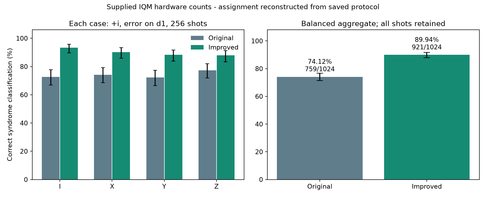
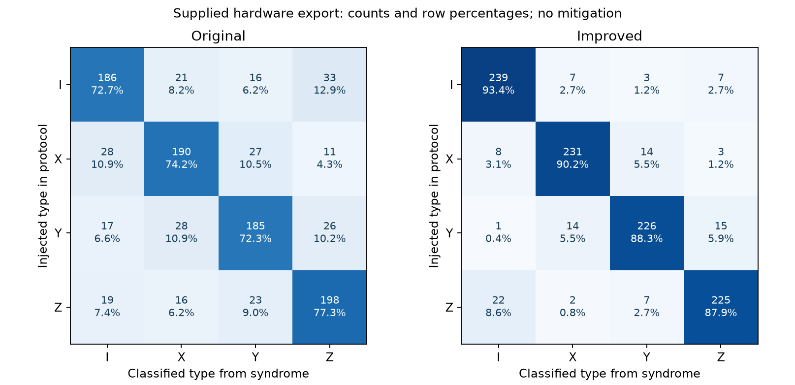
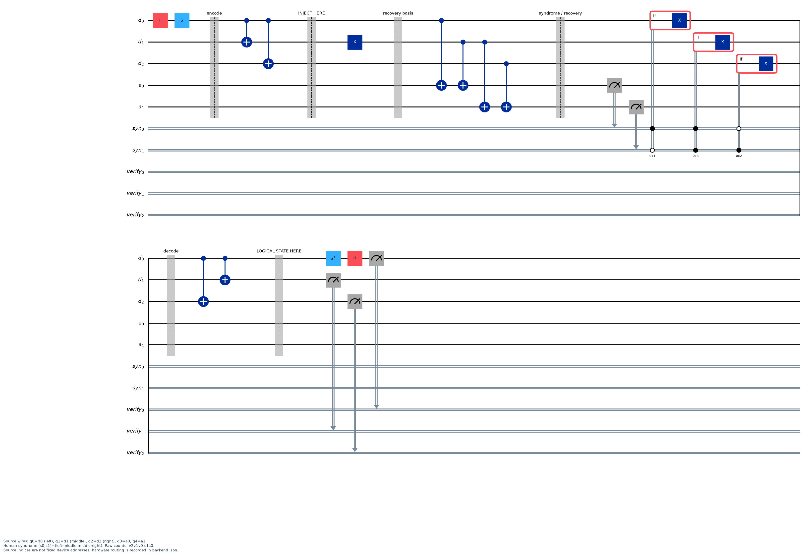
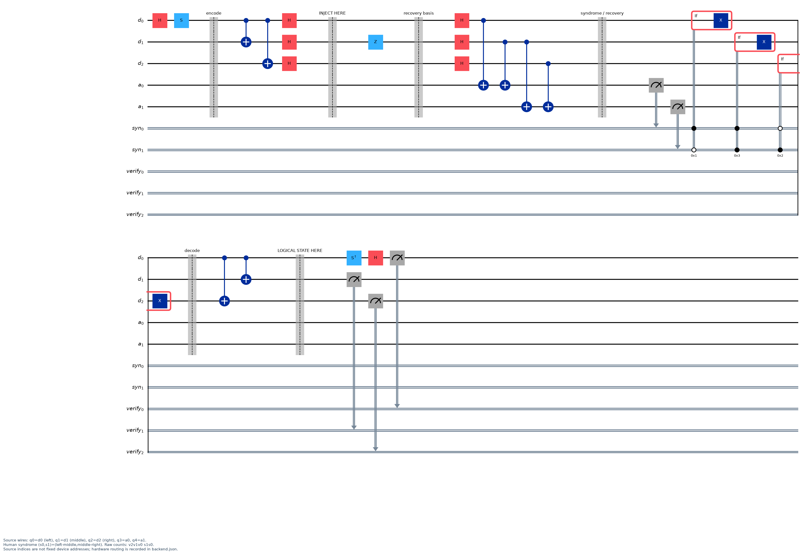
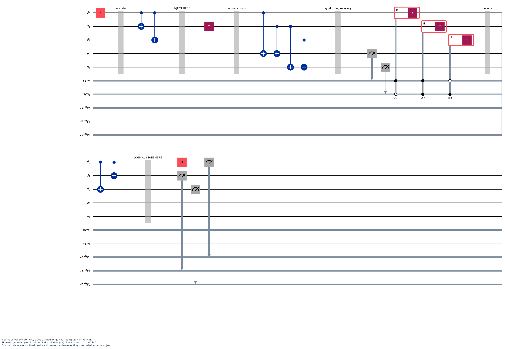
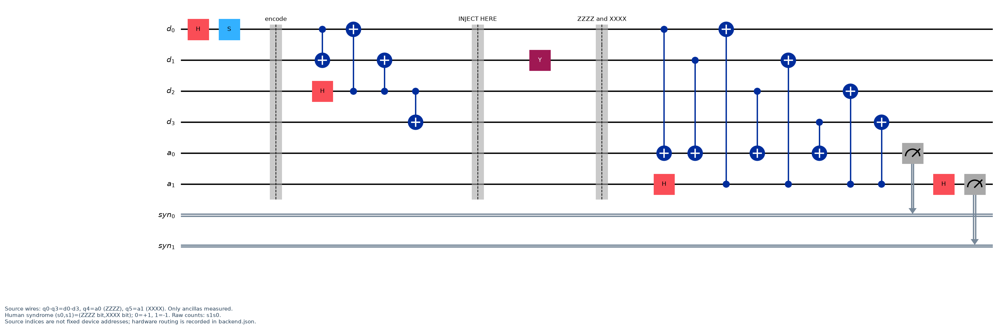
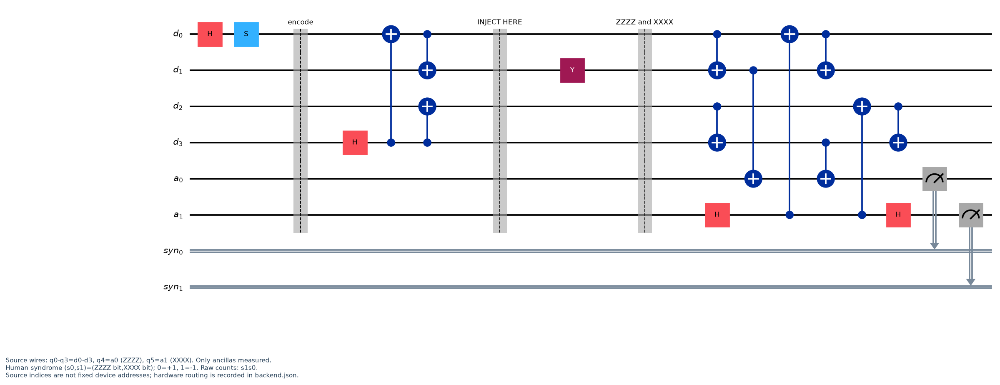

# QUBLITZ 2026 - Quantum Minesweeper: current submission report

## 1. Result and evidence boundaries

The supplied IQM export for job `01a20070-6eb5-7033-942a-a41474a1922e` contains eight circuits with 256 shots each. **Using the experiment order in QUBLITZ_Improved_Run_Ready.zip, original classification success is 759/1024 = 74.12%; improved success is 921/1024 = 89.94%.** The absolute change is **+15.82 percentage points**, approximate 95% Newcombe/Wilson interval **+12.55 to +19.07 points**. All 2,048 shots are used, without post-selection or readout mitigation.

**Provenance limitation:** the supplied export has counts and measurement keys, but no circuit names, input/error labels, backend name, layout, calibration link or timestamps. Array indices are associated with the unchanged prepared Run Ready protocol. The eight-circuit count, shot totals and asymmetric controls agree with it, but the original submitted job receipt was not supplied. Therefore the original/improved assignment and +i/d1 configurations are **reconstructed from that protocol, not independently verified from a receipt**. The job UUID comes from the supplied filename. These are user-supplied physical-result counts; no new job was submitted from this environment.

| Evidence source | Original | Improved |
|---|---|---|
| New supplied IQM export, protocol-reconstructed assignments | 759/1024 = 74.12% | 921/1024 = 89.94% |
| 95% Wilson interval, same export | 71.35-76.71% | 87.95-91.64% |
| Offline native compilation of +i/Y1 on IQM fake Garnet target | 24 CZ, 52 R, depth 45 | 11 CZ, 33 R, depth 17 |
| Ideal simulation, exact compiled Level-4 circuits | 78/78 input/error cases pass | 78/78 input/error cases pass |
| Archived calibration-noise simulation, same balanced cases | 89.65% | 93.77% |
| Earlier archived IQM pilot, likely +i/Y1 | 24/32 = 75% | No improved circuit in that pilot |

The resource reduction is 54.17% in native CZ instructions and 62.22% in gate-layer depth for the pilot case. Those are verified offline metrics, not measured pulse duration or independently recovered live-layout metrics. Physical logical-state fidelity was **not measured** by either export. The quantum-data preservation claim is verified in ideal simulation only.



## 2. Authoritative requirements and completion

All eight pages of `docs/source/challenge.pdf` were read; the latest attachment has identical SHA-256 `28c65d30fb860f1c3dcc3e411393b1c14aef9aaca23bda2e6a17d8ca156db717`. Pages 2-4 define Levels 1-4, page 5 requires at least one challenge circuit on IQM and explicitly does not require perfect experimental performance, and page 6 lists repository, challenge results, hardware evidence and a live demonstration.

Levels 1-3 recover the unknown state for all promised single-error locations and no error in ideal simulation. Level 4 classifies error type, without claiming correction or location identification. The supplied new hardware export provides a balanced four-type Level-4 experiment under the saved protocol. It does not experimentally test all 78 Level-4 inputs/locations or any Level-1-3 recovery. A public GitHub repository still needs to be published by the team; this ZIP is organized for that submission.

## 3. Bit ordering: asymmetric controls are essential

Source wires for Level 4 are q0-q3=d0-d3, q4=aZ, q5=aX. aZ writes `syn[0]`, the ZZZZ check; aX writes `syn[1]`, the XXXX check. A measured bit 0 means stabilizer +1; 1 means -1. Human syndrome order is `(s0,s1)=(ZZZZ,XXXX)`.

| Error | Check eigenvalues (ZZZZ,XXXX) | Human s0s1 | Export, declared key order | Qiskit display syn1syn0 |
|---|---|---|---|---|
| I | (+1,+1) | 00 | 00 | 00 |
| X | (-1,+1) | 10 | 10 | 01 |
| Y | (-1,-1) | 11 | 11 | 11 |
| Z | (+1,-1) | 01 | 01 | 10 |

Every export item lists `['syn_2_0_0','syn_2_0_1']`. The importer explicitly declares that character j belongs to measurement_keys[j], then normalizes to Qiskit display order. It never chooses an order by maximizing accuracy. The installed IQM SDK formatter independently confirms that native syn[0]=1/syn[1]=0 becomes Qiskit 01. Under the saved protocol, both X controls have mode export 10 and both Z controls have mode export 01, supporting the declared export convention. The symmetric Y=11 alone cannot establish that convention, and this new check does not retroactively prove the old pilot export order.

Raw counts below are **unchanged exported strings in the declared measurement-key order**, not Qiskit strings. Indices are zero based and assigned using the saved protocol. Input is +i throughout; X/Y/Z act on d1.

| Index | Variant | Error | 00 | 01 | 10 | 11 | Expected export |
| --- | --- | --- | --- | --- | --- | --- | --- |
| 0 | original | I | 186 | 33 | 21 | 16 | 00 |
| 1 | improved | I | 239 | 7 | 7 | 3 | 00 |
| 2 | improved | X | 8 | 3 | 231 | 14 | 10 |
| 3 | original | X | 28 | 11 | 190 | 27 | 10 |
| 4 | original | Y | 17 | 26 | 28 | 185 | 11 |
| 5 | improved | Y | 1 | 15 | 14 | 226 | 11 |
| 6 | improved | Z | 22 | 225 | 2 | 7 | 01 |
| 7 | original | Z | 19 | 198 | 16 | 23 | 01 |

| Type | Original correct / shots | Improved correct / shots | Change (pp) |
| --- | --- | --- | --- |
| I | 186/256 = 72.66% | 239/256 = 93.36% | +20.70 |
| X | 190/256 = 74.22% | 231/256 = 90.23% | +16.02 |
| Y | 185/256 = 72.27% | 226/256 = 88.28% | +16.02 |
| Z | 198/256 = 77.34% | 225/256 = 87.89% | +10.55 |

Per-case Wilson intervals and both the unchanged export and normalized Qiskit counts are in `results/iqm-hardware-analysis/analysis.json`, `per-case.csv` and `imported-comparison.json`.



Rows above are protocol-injected types, columns are classified solely from measured syndrome. Every row sum is 256. The aggregate is equally weighted across I, X, Y and Z. Wilson intervals describe binomial shot uncertainty. The difference interval is an independent-binomial approximation; it does not quantify correlated drift, protocol-assignment uncertainty or unmeasured logical fidelity. The observed gain is evidence for this supplied batch and protocol assignment, not a guarantee for future calibrations.

## 4. Level 1: correct an unknown X error

Data d0,d1,d2 are left,middle,right. Ancillas q3=a0 and q4=a1 store (d0 XOR d1,d1 XOR d2). Start with `(alpha|0>+beta|1>)|00>` and encode with CX(d0,d1), CX(d0,d2). For a middle X error, the data evolves as follows:

| Stage | Data, human order d0 d1 d2 | Ancillas a0 a1 |
|---|---|---|
| Prepare | alpha 000 + beta 100 | 00 |
| Encode | alpha 000 + beta 111 | 00 |
| Inject X on d1 | alpha 010 + beta 101 | 00 |
| Extract, then measure syndrome | alpha 010 + beta 101 | 11 |
| Syndrome-controlled X on d1 | alpha 000 + beta 111 | 11 |
| Decode | (alpha 0 + beta 1) tensor 00 | 11 |

Each parity is computed with two CNOTs into an initially zero ancilla. Both logical components receive the same ancilla value 11, so the final state factors into data superposition tensor ancilla 11. Reading those ancillas learns neither alpha nor beta nor which component the data occupies. This argument applies to the promised encoded-error subspace, not to unrestricted data states.

| Human syndrome (left-middle,middle-right) | Recovery location |
|---|---|
| 00 | None |
| 10 | Left d0 |
| 11 | Middle d1 |
| 01 | Right d2 |

The chosen X is squared with the injected X, so both encoded basis states are restored with the same global phase +1. By linearity every alpha/beta superposition is restored. The circuit diagram measures syndrome before dynamic recovery; the IQM-compatible Level-1 alternative defers measurement and uses coherent syndrome control.



## 5. Level 2: turn Z into X by interference

For one qubit, H|+>=|0> and H|->=|1>. Before H both inputs yield equal 0/1 probabilities; H adds or cancels their amplitudes so their relative sign becomes distinguishable. H acts on one qubit, with H|0>=(|0>+|1>)/sqrt(2) and H|1>=(|0>-|1>)/sqrt(2).

Encode the repetition state, apply H to all three data qubits, **inject the test Z here**, then apply H to all three again. H Z H = X turns the phase error into the matching bit error. Extract the Level-1 parities and recover with X in this restored computational basis; decode and verify d0 **before** inverse input preparation. Both encoded basis states again receive phase +1. Test harness labels are used for preparation/scoring, never for recovery selection.



## 6. Level 3: promised Y requires Y recovery

Y maps 0 to i1 and 1 to -i0. A middle Y gives `i alpha 010 - i beta 101`; both bit patterns still have syndrome 11. Because the error model promises Y, the syndrome locates the qubit and the recovery applies Y there. Y squared is I, with global phase +1 on both logical basis states.

The controlled + input comparison gives fidelity 1 with Y recovery and fidelity 0 with X-only recovery. X-only restores the encoded bit patterns but leaves `i(alpha 000-beta 111)`, or a logical Z phase after decoding. Equal computational-basis probabilities do not prove quantum-state restoration.



## 7. Level 4 and the shallower equivalent circuit

The orthogonal codewords, in human d0 d1 d2 d3 order, are `|0L>=(|0000>+|1111>)/sqrt(2)` and `|1L>=(|0011>+|1100>)/sqrt(2)`. They select two dimensions of the four-dimensional common +1 eigenspace of ZZZZ and XXXX. Both stabilizers act identically on the two logical codewords. A Pauli error changes a stabilizer sign exactly when it anticommutes with that check, independently of alpha and beta and of the data location. Thus X changes ZZZZ, Z changes XXXX and Y changes both.

The preserved original encoder is CX(0,1), H(2), CX(2,0), CX(2,1), CX(2,3). The improved encoder is **H(3), CX(3,0), CX(0,1), CX(3,2)**. With input bit b and H-generated bit g, its output is `(b XOR g,b XOR g,g,g)`, giving exactly the same two codewords with the same relative phase.

Let C be CX(0,1) followed by CX(2,3). Conjugation maps ZZZZ to Z1 Z3 and XXXX to X0 X2. Apply C; extract Z1 Z3 with CX(1,aZ), CX(3,aZ); extract X0 X2 with H(aX), CX(aX,0), CX(aX,2), H(aX); apply C again. The undo is essential: it restores the post-error encoded data after writing the checks. The check map agrees with the original on all 16 data basis vectors with ancillas zero, so it also agrees on arbitrary superpositions by linearity.

Encoding finishes before the labeled injection barrier. The injected Pauli is never absorbed into preparation or used by the classifier. Only ancillas are finally measured, and no mid-circuit measurements or classical feed-forward are needed.





## 8. Calibration and supported target

The unchanged quality-metric snapshot was created at `2026-11-21T02:43:01.804237+00:00`, with described calibration ID `ea681de1-9661-41e5-bd6f-cb524fa056a6`, device label `M194_F0W2114_P08_B15`. It provides 20 qubits and 30 CZ edges; invalid observations, units, probabilities, timestamps and duplicates are checked. The unheralded asymmetric readout metrics are used separately for 0-to-1 and 1-to-0 errors. Pulse durations are absent, so execution time cannot be estimated defensibly from this snapshot.

The official offline IQM fake Garnet topology has exactly those qubit names and CZ edges. Native R, CZ, barriers and terminal measurements are checked against that supported target, including each physical two-qubit edge. The live QPU identity and its run-time calibration were not present in the export; topology compatibility does not establish them. All reported physical layouts below belong to **verified offline compiled artifacts**, and need the original receipt to certify their use in this job.

Placement searches bounded layout/seed candidates using one calibration ranking heuristic across all inputs/errors. It combines conservative gate fidelities, worst-bit unheralded readout cost, CZ count and a depth tie breaker; it is not a predicted accuracy. Selected layouts are frozen before evaluation. The placement-only candidate uses 24 CZ, depth 46, with no new physical result. The selected rewrite plus placement uses 11 CZ, depth 17 for +i/Y1. This experiment cannot separate the causal contributions of rewriting and placement.

Layout order is `(d0,d1,d2,d3,aZ,aX)`; backend indices are zero based, and QBn is index n-1.

| Variant | Initial device names | Final device names | Measured ZZZZ,XXXX |
| --- | --- | --- | --- |
| original | QB4,QB3,QB1,QB2,QB9,QB5 | QB3,QB9,QB1,QB5,QB2,QB4 | QB2,QB4 |
| placement | QB8,QB3,QB9,QB14,QB4,QB13 | QB13,QB3,QB14,QB9,QB4,QB8 | QB4,QB8 |
| improved | QB5,QB2,QB9,QB4,QB1,QB10 | QB5,QB2,QB9,QB4,QB1,QB10 | QB1,QB10 |

Exact saved packet metrics, including every input/error pair used in the supplied batch:

| Index | Variant | Case ID | CZ | R | Depth |
| --- | --- | --- | --- | --- | --- |
| 0 | original | +i_I_None | 24 | 51 | 44 |
| 1 | improved | +i_I_None | 11 | 32 | 16 |
| 2 | improved | +i_X_1 | 11 | 33 | 17 |
| 3 | original | +i_X_1 | 24 | 52 | 45 |
| 4 | original | +i_Y_1 | 24 | 52 | 45 |
| 5 | improved | +i_Y_1 | 11 | 33 | 17 |
| 6 | improved | +i_Z_1 | 11 | 32 | 16 |
| 7 | original | +i_Z_1 | 24 | 51 | 44 |

Software used locally: Python 3.12.14, Qiskit 2.1.2, Aer 0.17.2, iqm-client 36.0.0, NumPy 2.5.5. Hardware compilation was validated on `IQMFakeGarnetBackend`; do not replace that label with a claimed physical backend name. The live runner obtains the actual backend and revalidates its target. Resonator/MOVE targets are explicitly rejected by this exact-Aer comparison implementation.

## 9. Tests, exact native replay and noise simulations

Before new edits, the existing improved project passed **718 tests**, and the latest Run Ready SDK-token fixes also passed **718 tests**. The original development baseline has archived **300 passing tests**; it was reproduced in the earlier improvement study, not rerun from the untouched ZIP during this import. Current full regression: **744 passed, zero failures/errors/skips**. Evidence is `results/pytest.txt`, `pytest.xml`, `test-outcome.json`, and the two pre-import JUnit files.

| Level | Input/error cases | Error configurations | Minimum ideal fidelity | Finite shots | Every case success |
| --- | --- | --- | --- | --- | --- |
| 1 | 24 | 4 | 1.000000000000 | 12,288 | 100% |
| 2 | 24 | 4 | 1.000000000000 | 12,288 | 100% |
| 3 | 24 | 4 | 1.000000000000 | 12,288 | 100% |
| 4 | 78 | 13 | 1.000000000000 | 39,936 | 100% |

For Levels 1-3 the fidelity is the decoded state against the input, before inverse preparation; finite shots use inverse input preparation and verify the expected all-zero data outcome and syndrome. For Level 4 the fidelity compares data after extraction with the encoded data immediately after injection, not with an uncorrupted codeword. The original 150 cases include 24 cases per recovery level and 78 classification cases, six logical inputs each.

The full regression also checks all 13 Level-4 errors across six inputs on each of original, placement and improved exact native variants: 234 statevector cases. Source isometry checks include both encoder codewords and all 16 extraction columns. X and Z controls fail under a bit swap. Fresh replay of the exact eight saved QPY circuits verifies their gate/register/global-phase fingerprints, layout metadata and target compatibility; data-preservation fidelity is at least **0.999999999999998**, and all **2048/2048 ideal shots** are correct. This certifies the saved offline packet, not an unavailable live native circuit.

The archived calibration-noise model predicts 89.65% original versus 93.77% improved on the balanced subset: +4.13 points, with separate evaluation seeds 49157 and 82799 and 4096 shots per variant. These are **noise simulations**, distinct from both the generic fake Garnet archive and physical counts. Independent depolarization and asymmetric unheralded readout omit leakage, coherent/correlated errors, crosstalk, initialization faults, drift and idle timing. Their physical-rate mismatch is observed; these attachments do not identify its cause. Reducing entanglers and routing is a plausible contributor to the measured gain, not a proven causal explanation.

## 10. Reproduction, receipt retrieval and live demonstration

From an extracted project folder, install with `bash scripts/setup.sh` (Python 3.12). Then run `bash scripts/reproduce_submission.sh`. It checks dependencies, runs all tests, regenerates the 150-case simulation, imports all physical counts, replays the exact native packet and rebuilds this report, Japanese guide and offline demo. It makes **no hardware submission**.

The explicit import command is:

```bash
.venv/bin/python -m minesweeper compare --mode import-export \
  --export-file data/iqm-comparison-01a20070/export.json \
  --protocol-file results/comparison-prepared/manifest.json \
  --export-bit-order measurement-keys \
  --job-id 01a20070-6eb5-7033-942a-a41474a1922e --out results/iqm-hardware-analysis
```

To retrieve the already completed job and archive its actual submitted IQM circuits, parameters, calibration IDs and timeline, use the original event server/QPU configuration and your private credentials. Do not resubmit merely to obtain a receipt:

```bash
export IQM_SERVER_URL='YOUR_ORIGINAL_EVENT_SERVER_URL'
export IQM_QUANTUM_COMPUTER='YOUR_ORIGINAL_QPU_NAME'
.venv/bin/python -m minesweeper compare --mode retrieve \
  --job-id 01a20070-6eb5-7033-942a-a41474a1922e \
  --protocol-file results/comparison-prepared/manifest.json \
  --out results/iqm-comparison-retrieved --prompt-token
```

This writes `job.json` and `iqm-result.json`. Inspect returned circuit names/order, physical instructions, measurement keys and calibration linkage against the saved packet; retrieval alone does not certify a reconstructed protocol. Use the original receipt as `--protocol-file` when importing if you have it. The old single-pilot `iqm --mode retrieve` workflow remains available.

Live demo: open `docs/live-demo.html` offline, select Level 1/+i/middle X, and step through preparation, encoding, injection, extraction, correction, decoding and inverse-preparation verification. The beginning shows 010 and 101 with the same parity 11. Scroll to the hardware section for the actual supplied counts and their provenance label. A reproducible terminal walkthrough is:

```bash
.venv/bin/python -m minesweeper demo --level 1 --input +i \
  --error X --location 1 --shots 512 --out results/submission-demo
```

English presentation: “We compare the original and optimized Level 4 circuits using a balanced I, X, Y, and Z protocol. Under the saved protocol's circuit-order assignment, the supplied IQM job export gives 74.12% correct syndrome classifications for the original and 89.94% for the optimized circuit. Ideal simulations verify that both checks preserve the encoded data, while these hardware counts measure classification accuracy, not logical-state fidelity.”

## Final submission checklist and first command

**First command:** `bash scripts/setup.sh` from the extracted project folder. If dependencies are already installed, `bash scripts/reproduce_submission.sh` reproduces the current evidence without contacting IQM.

**Tests actually run:** the two pre-import suites each passed 718 tests; the updated full suite passed 744, with zero failures/errors/skips. The fresh exhaustive benchmark passed 150/150 cases and 76,800/76,800 ideal shots. Exact archived native replay passed 8/8 circuits and 2048/2048 ideal shots. The Level-1 middle-X demo verifies the original complex superposition after decoding.

**Verified on IQM hardware by the supplied evidence:** eight count histograms, 256 shots each, supplied as job `01a20070-6eb5-7033-942a-a41474a1922e`. Under the saved protocol assignment, Level-4 classification is 74.12% original and 89.94% improved. No logical-state fidelity, Levels 1-3 recovery, complete 78-case hardware coverage or live physical layout is established by this export.

**Still needed before submission:** recover and audit the original receipt/native circuit/backend/calibration linkage to remove the protocol-assignment qualification; publish the GitHub repository with these files and raw evidence; rehearse the Japanese explanation and English demo. A repeat hardware job can test reproducibility, but should use a fresh, explicitly authorized output directory and is not needed merely to analyze these counts. Perfect experimental accuracy is not a challenge requirement.
